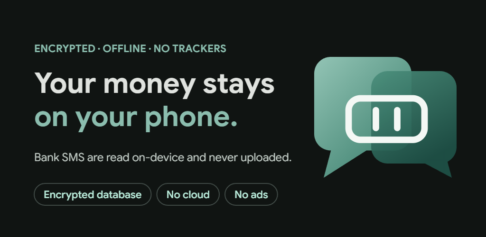
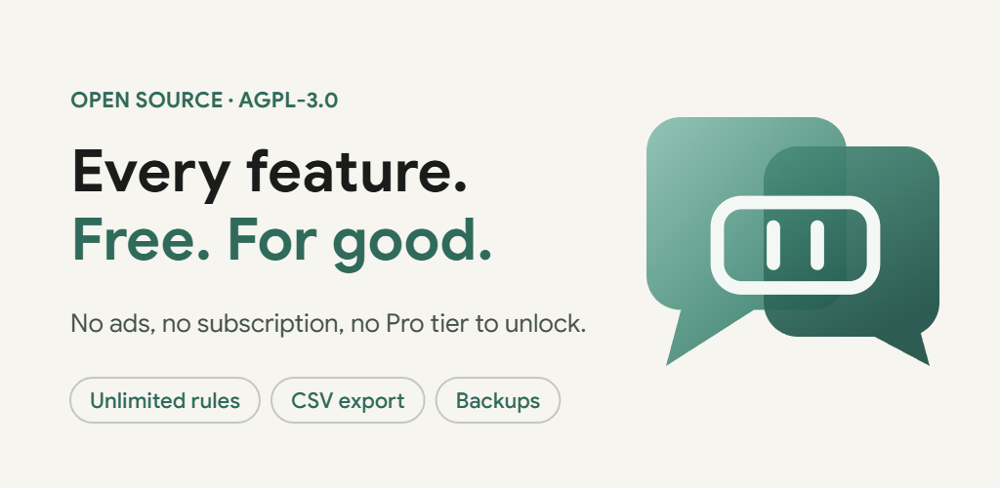
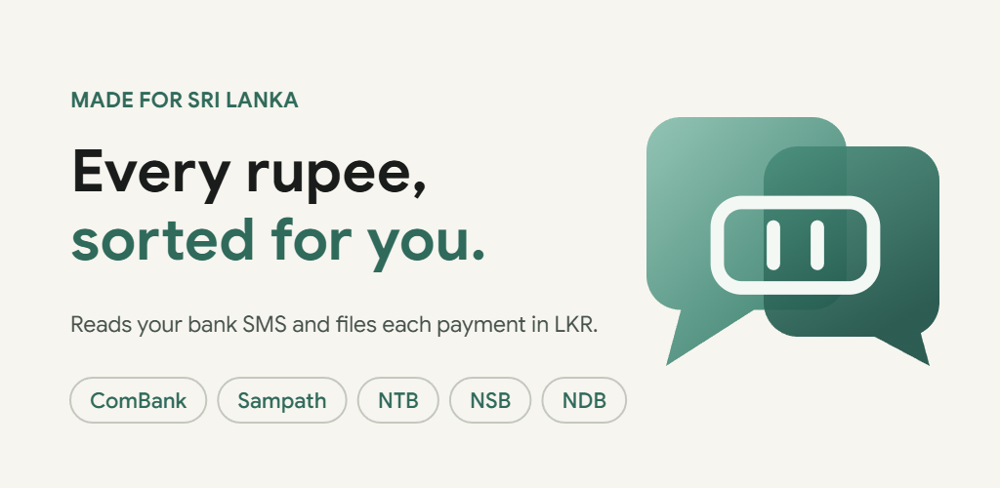

<!-- Mudal fork: modified from PennyWise AI (AGPL-3.0-only) on 2026-10-21 - see NOTICE. -->
# Mudal (මුදල්) — Private SMS Expense Tracker


Mudal is an offline-first, privacy-focused expense tracker designed for Sri Lanka and beyond. It transforms bank SMS into a clean timeline of accounts, transactions, budgets, and subscriptions — entirely on your device with zero cloud tracking.

[](LICENSE)
[](https://developer.android.com/about/versions/oreo/android-8.0)
[](https://kotlinlang.org/)
[](docs/PRIVACY.md)

---

## Key Highlights

- **🔒 100% Private & On-Device:** All SMS parsing, financial summaries, and SQLite storage stay strictly on your phone.
- **🇱🇰 Sri Lankan Defaults:** Native default currency in Sri Lankan Rupee (`LKR`, `Rs.`) with locale-aware number formatting.
- **🔓 Fully De-commercialized & Unlocked:** Zero paywalls, zero ads, zero in-app purchases. Unlimited rules, PDF statement imports, CSV exports, recurring templates, and account merges are 100% unlocked.
- **🛡️ No Telemetry or Trackers:** No Google Analytics, Firebase, Sentry, or third-party device tracking. `BILLING` permission completely removed.
- **⚡ Zero Setup & Smart SMS Parsing:** <!-- BANKS_SUMMARY -->5 banks across 1 country<!-- /BANKS_SUMMARY --> with real-time detection of incoming SMS.

---

## Features

### Private by design



Bank SMS are parsed on the device and never uploaded. The database is encrypted with a key that never leaves the phone, Mudal can be locked behind your fingerprint or PIN, and its contents are hidden in the recent-apps switcher. The only network calls are the ones you opt into — see [docs/PRIVACY.md](docs/PRIVACY.md).

### Budgets, goals and subscriptions


- **Automatic from bank SMS** — card payments, ATM withdrawals and transfers become transactions as the SMS arrives.
- **Every account in one place** — savings, current and credit-card accounts with balances and balance history.
- **Budgets** — weekly, monthly or one-off, over the categories you choose.
- **Savings goals** — see what you have saved and whether you are on pace.
- **Subscriptions & recurring** — track bills and schedule the payments your bank never texts you about.
- **Analytics** — category breakdowns, trends and month-on-month comparisons.
- **Rules** — auto-categorise by merchant, amount or text, applied to new and past transactions.
- **Loans & split bills** — money lent and borrowed, and shared bills without a spreadsheet.
- **Home-screen widgets** — recent transactions, a category chart and your goals.
- **Optional AI assistant** — ask questions about your spending with your own Google Gemini key. Off unless you turn it on.

### Free, with nothing locked



No ads, no subscription and no Pro tier. Unlimited rules, CSV export, PDF statement import, scheduled backups and every other feature are available to everyone, and the source is public under the AGPL-3.0.

### Look and feel

Mudal uses a single green palette taken from its logo, with a cream light theme and a dark theme (the default). Text is set in Google Sans, the bottom bar is the standard Material 3 navigation bar with optional blur, and the home screen has a soft gradient in the logo's greens. The app opens on an animated version of the logo.

---

## Supported Banks & Countries



<!-- SUPPORTED_BANKS:START (generated by scripts/update-supported-banks.sh — do not edit by hand) -->
Supporting **5 banks & services** across **1 country** with **multi-currency** capabilities:

### 🇱🇰 Sri Lanka — LKR Rs (5)
**Commercial Bank**, **National Development Bank**, **National Savings Bank**, **Nations Trust Bank**, **Sampath Bank**
<!-- SUPPORTED_BANKS:END -->

---

## Upstream & Attribution

Mudal is an independent fork of [PennyWise AI](https://github.com/sarim2000/pennywiseai-tracker) by Mohammad Sarim and contributors, licensed under the GNU Affero General Public License v3.0 (AGPL-3.0-only).

Mudal is not endorsed by, affiliated with, or sponsored by the PennyWise project. The PennyWise name, logo and banner artwork are trademarks of their owner and are not used here — see [TRADEMARKS.md](TRADEMARKS.md).

See [NOTICE](NOTICE), [ATTRIBUTION.md](ATTRIBUTION.md), [docs/MODIFICATIONS.md](docs/MODIFICATIONS.md) and [docs/PRIVACY.md](docs/PRIVACY.md) for the full licensing, modification record and network audit.

---

## Building from Source

### Prerequisites
- JDK 21 (the Android Studio bundled JBR is the easiest source)
- Android SDK Platform 36 and 37, Build-Tools 36+ (`compileSdk = 37`, `minSdk = 26`, `targetSdk = 36`)

### Build Commands
```bash
# Run parser test suite
./gradlew :parser-core:jvmTest

# Run app unit tests
./gradlew :app:testDebugUnitTest

# Assemble debug APK
./gradlew :app:assembleDebug
```

Output APK is generated at:
`app/build/outputs/apk/debug/app-debug.apk` — application ID `com.mudal.tracker` (`.debug` suffix on debug builds).

> The Kotlin package namespace is still `com.pennywiseai.tracker` and the
> `parser-core` module keeps its upstream layout. That is deliberate: it keeps
> the diff against upstream reviewable and makes upstream merges tractable.

---

## License

Licensed under the **GNU Affero General Public License v3.0 (AGPL-3.0-only)** — see [LICENSE](LICENSE) for the full terms, [NOTICE](NOTICE) for the copyright and attribution notice, and [ATTRIBUTION.md](ATTRIBUTION.md) for the third-party component list.

Mudal is a modified version of PennyWise AI. Every modified file carries a `Mudal fork:` notice; the full change list is in [docs/MODIFICATIONS.md](docs/MODIFICATIONS.md).

---

## Project documents

| Document | What it covers |
|---|---|
| [docs/PRIVACY.md](docs/PRIVACY.md) | Every network endpoint that remains, when it is used, and what is sent |
| [docs/FORK_PLAN.md](docs/FORK_PLAN.md) | The phased plan for this fork and the v1.0 scope |
| [docs/FORK_NOTES.md](docs/FORK_NOTES.md) | Dated decisions, audit findings and operational procedures |
| [docs/MODIFICATIONS.md](docs/MODIFICATIONS.md) | What Mudal changed, file by file (AGPL §5(a)) |
| [docs/lk-samples/](docs/lk-samples/) | Real, masked Sri Lankan bank SMS used as parser fixtures |
| [docs/adding-bank-parsers.md](docs/adding-bank-parsers.md) | How to add a bank parser |
| [branding/](branding/) | The Mudal logo (static and animated SVG) and Play Store feature graphics |
