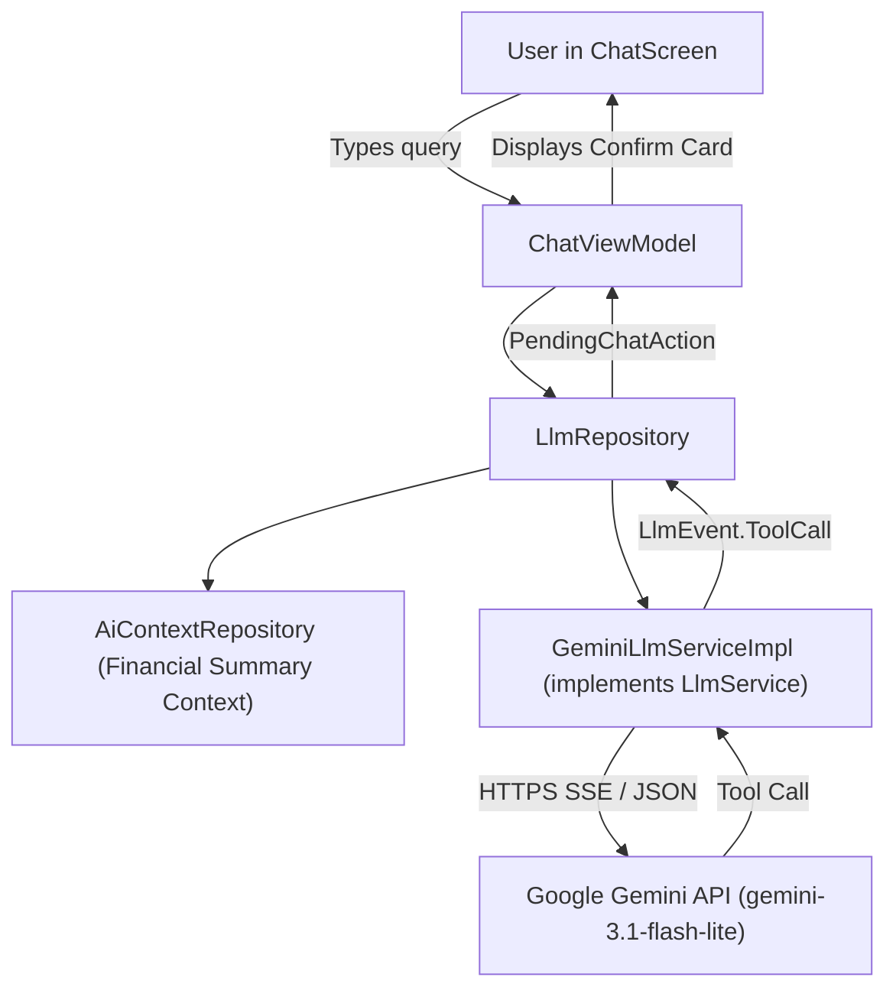

# Design Document: Google Gemini 3.1 Flash-Lite Integration

**Date**: 2026-10-21  
**Status**: Draft  
**Target Model**: `gemini-3.1-flash-lite`

---

## 1. Intent and Why

### Context
Mudal (formerly PennyWise AI) previously included an on-device Large Language Model subsystem powered by Google's LiteRT-LM runtime. This required users to download an ~1.6 GB `.litertlm` model file to device storage, consumed significant RAM/CPU on mobile devices, and introduced complex download state tracking, file integrity verification, and runtime crashes.

### Purpose
Replace the local on-device LLM with the Google Gemini Cloud API using the **`gemini-3.1-flash-lite`** model. Users provide their own personal API key (free tier from Google AI Studio). This provides instant onboarding (no multi-gigabyte downloads), near-instant inference, advanced reasoning, and full function calling support while dramatically shrinking the app package and memory footprint.

---

## 2. Goals, Non-Goals, and Anti-Goals

### Goals
1. **Gemini 3.1 Flash-Lite as Core Engine**: Use `gemini-3.1-flash-lite` via the Gemini REST API for chat generation and streaming responses.
2. **BYOK (Bring Your Own Key)**: Allow users to enter and store their Gemini API key securely in the app via Datastore / Keystore.
3. **Chat Setup Flow**: In `ChatScreen`, if no key is set, present an onboarding/setup card with an input field and a one-tap link to generate a free key at [Google AI Studio](https://aistudio.google.com/app/apikey).
4. **Settings Management**: In `SettingsScreen`, replace the 1.6 GB model download section with a Gemini API configuration section (view status, edit key, test connection, clear key).
5. **Retain Existing Financial Capabilities**:
   - Monthly summary & spending context injected via system prompt (`AiContextRepository`).
   - Function calling / Tool support (`PennyWiseTools`) for adding, updating, and deleting transactions with user confirmation cards.
6. **Clean Removal of LiteRT-LM**: Remove `ModelDownloader`, `libs.litertlm.android`, and local model verification logic.

### Non-Goals
- Supporting non-Gemini LLM providers (e.g. OpenAI, Anthropic) in this phase.
- Multi-modal image/audio input in chat (text-only conversation remains standard).
- Cloud storage/sync of chat history (chat history remains strictly local in Room database).

### Anti-Goals
- **No Automatic Mutations**: Tool calls from Gemini must NEVER automatically write to the database. All financial actions (`add_transaction`, `update_transaction`, `delete_transaction`) must continue to require explicit user confirmation via UI cards.
- **No Background Telemetry/Leaking**: The API key and chat data must only be sent to `generativelanguage.googleapis.com` over HTTPS.

---

## 3. Constraints & Technical Boundaries

1. **Android & Ktor**: Use the existing Ktor HTTP client already included in the app (`ktor-client-android`, `ktor-client-content-negotiation`, `kotlinx.serialization`) to perform HTTP SSE streaming to Google Generative Language API endpoints. No heavy third-party SDKs required.
2. **Network Resilience**: Gracefully handle network offline states, rate limits (HTTP 429), and invalid API keys (HTTP 400/403) with user-friendly error banners.
3. **Privacy Transparency**: Inform the user clearly in the UI that chat queries and financial summaries are transmitted to Google's Gemini API.

---

## 4. Architecture & Component Design

## 4. Architecture & Component Design

### 4.1 Data Storage, Security & Backup Portability
*(Builder resolution)*:
- **Storage**: Store the API key in `UserPreferencesRepository` using Android Jetpack DataStore preferences (`KEY_GEMINI_API_KEY`).
- **Backup Exclusion**: Explicitly exclude the Gemini API key from `PennyWiseBackup` / JSON backup exports to ensure user API credentials are never written to unencrypted backup files or leaked when backups are transferred.
- **Readiness State**: `apiKeyConfigured` is a reactive Flow checking if `geminiApiKey?.isNotBlank() == true`. Users can open and read previous chat history offline. An explicit network error banner is shown if an active request fails due to no internet or an invalid key.

### 4.2 History Management & Sliding Window
*(Builder resolution)*:
- **Sliding Window**: Remove the legacy 1,200-token hard cutoff from LiteRT-LM. Instead, use a sliding window of the last 20 conversation turns from Room DB.
- **Payload Structure**: Each turn in `contents` is serialized as standard `{role: "user" | "model", parts: [{text: "..."}]}`. The rich system prompt from `AiContextRepository` is passed in `system_instruction`. This keeps mobile data usage low (~5-10 KB per request) while preserving immediate conversation continuity.

### 4.3 Tool Call & Mutation Contract
*(Builder resolution)*:
- **Tools Schema**: Export `PennyWiseTools` (`add_transaction`, `update_transaction`, `delete_transaction`, `month_summary`, `spending_by_category`) into Gemini's `tools` array (`functionDeclarations`).
- **Confirmation Interception**:
  - For mutations (`add_transaction`, `update_transaction`, `delete_transaction`): Gemini generates a `functionCall`. The app intercepts the call and posts a `PendingChatAction` confirmation card to `ChatViewModel`. Nothing is written to the database until the user explicitly taps "Confirm".
  - When the user confirms or dismisses, the app appends the resulting confirmation message (e.g. `"Added 1,500 LKR at Ceypetco (Fuel)."`) as a plain assistant message in the local Room DB. This preserves the existing Room schema without needing complex multi-turn functionResponse re-hydration across sessions.
  - Read tools (`month_summary`, `spending_by_category`) are either served directly by Gemini using the pre-injected financial context in `system_instruction` or resolved locally via `AiContextRepository`.

### 4.4 UI Updates
- **`ChatScreen.kt`**:
  - Replace `ModelState.NOT_DOWNLOADED` / `DOWNLOADING` views with `GeminiApiKeyCard`.
  - Content: Title ("Setup Gemini AI"), explanation, key input field, "Get Free Key" external link, "Save Key" button.
  - When key is valid: Chat input bar is active.
- **`ChatViewModel.kt`**:
  - Replace `modelDownloader` / `modelState` flows with `apiKeyConfigured: StateFlow<Boolean>`.
  - Expose `saveApiKey(key: String)` and `validateApiKey(key: String): Flow<Result<Unit>>`.
- **`SettingsScreen.kt` & `SettingsViewModel.kt`**:
  - Replace "AI Model Download" card with "Google Gemini AI Settings".
  - Shows current status (Configured / Missing Key), masked key preview (`AIzaSy...****`), and edit/clear dialog.

### 4.5 LiteRT Cleanup
- Remove `com.pennywiseai.tracker.data.manager.ModelDownloader`.
- Remove `ModelRepository` or adapt it into `GeminiConfigRepository`.
- In `pennywiseai-tracker/app/build.gradle.kts`: remove `libs.litertlm.android`.
- In `gradle/libs.versions.toml`: remove `litertlm` artifact references.

---

## 5. What is Left to the Builder

- Exact layout details of the API key dialog in Settings (Material 3 standard styling matching app conventions).
- Validation test helper (simple lightweight `models.get` or ping test when user saves their key to immediately confirm validity).
- Unit tests for SSE response parsing and tool call serialization.
